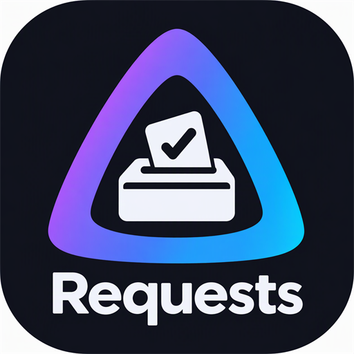

<p align="center"></p>

# Jellyfin Requests

Let your users request movies and TV shows right inside Jellyfin, and manage every request from the dashboard. No external services or API keys required.

## Features

- **Requests button in the header** for every signed-in user, opening a search page that follows your theme and custom CSS.
- **Search** through the metadata providers already configured in Jellyfin. Duplicate results from different providers are merged, and titles you already have are marked *In library*.
- **Flexible requests:** whole movies, whole series, specific seasons or specific episodes, with a preferred quality and an optional note.
- **My Requests:** users see the status of everything they asked for and can cancel requests that haven't been processed yet. Titles someone else already requested are marked *Already requested*.
- **Administration** (Dashboard → Requests): filter, sort and update every request; configure media types, quality options and statuses (name, color and icon); optional animations.

## Requirements

- Jellyfin 12.4 or later

## Installation

1. In Jellyfin, go to **Dashboard → Plugins → Repositories** and add:

   ```text
   https://raw.githubusercontent.com/Theonebox/Jellyfin-Requests-Plugin/main/manifest.json
   ```

2. Install **Requests** from the Catalog and restart Jellyfin.
3. Reload the web client. The Requests button appears in the header, next to SyncPlay.
